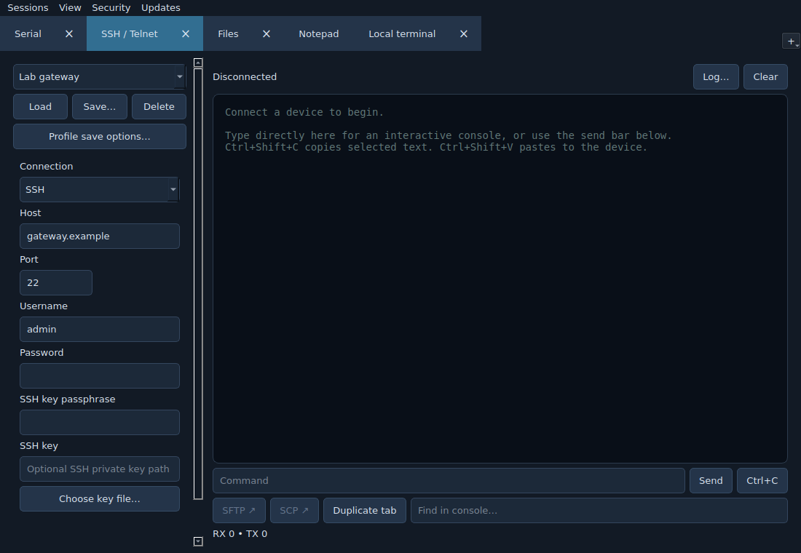
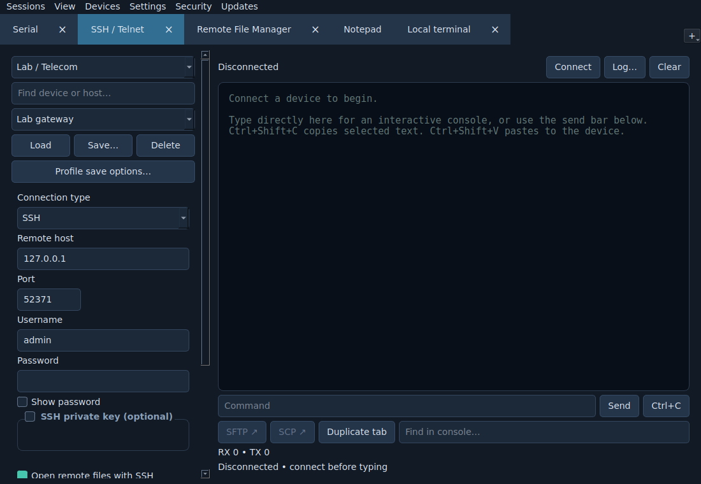
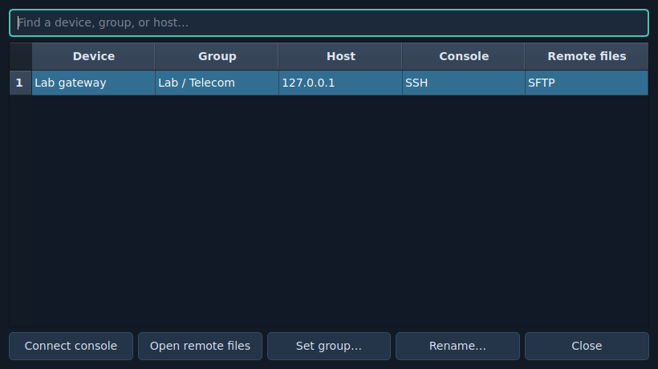
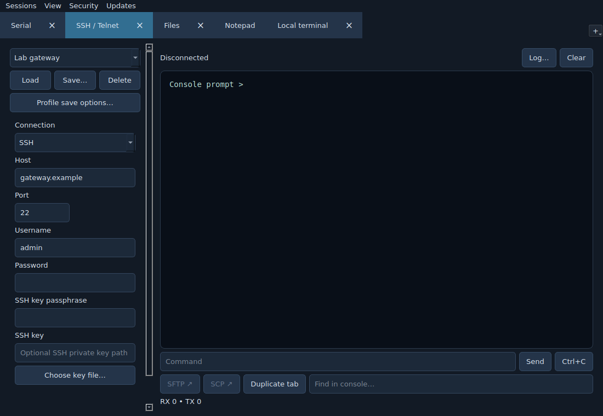
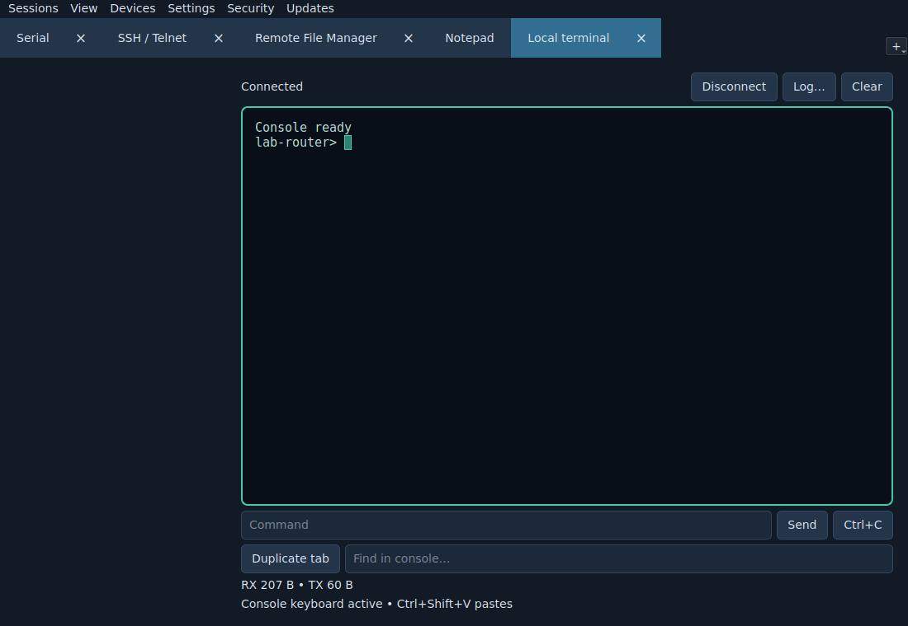
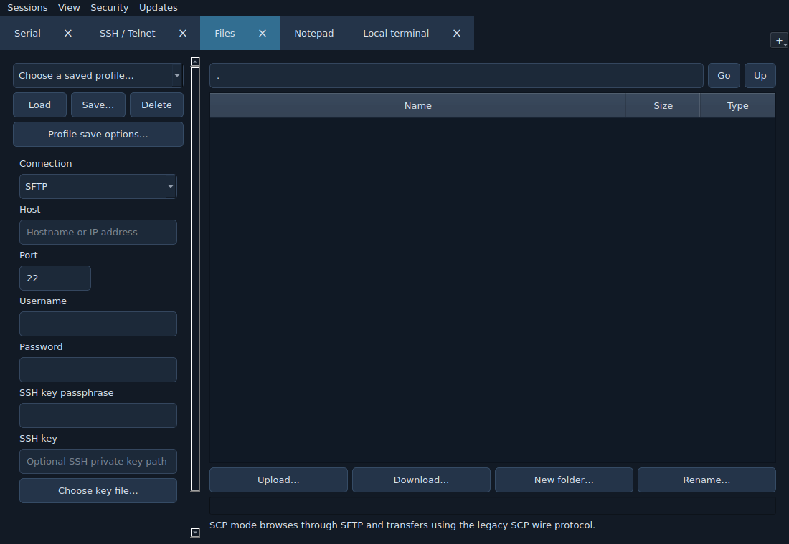
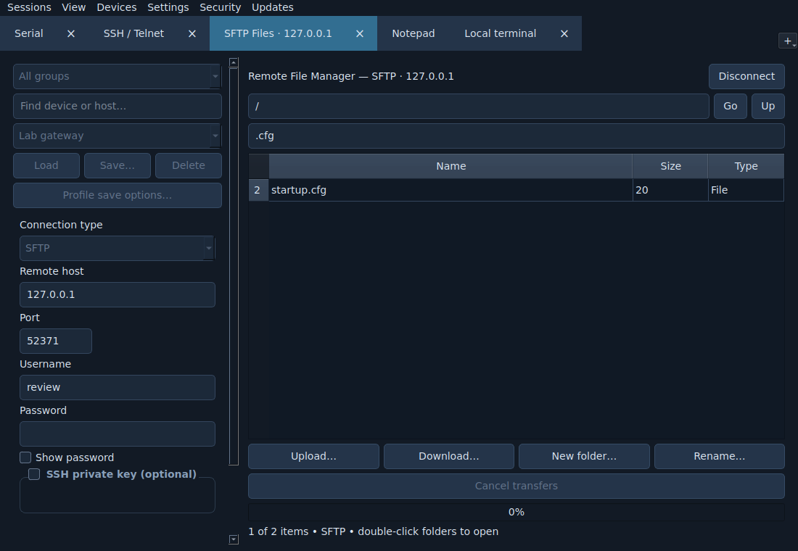
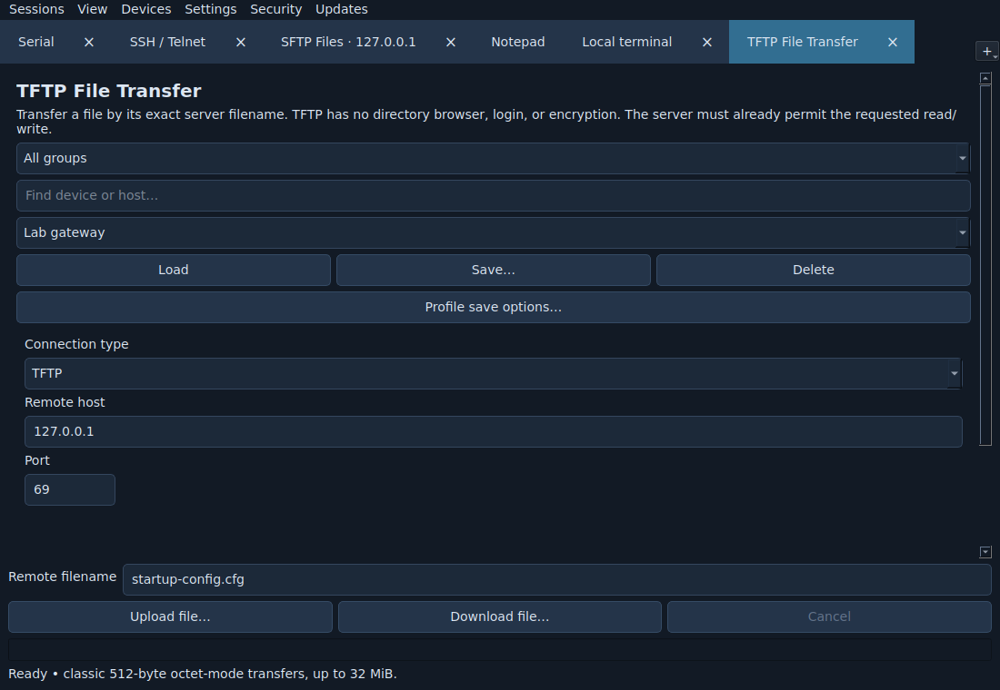

# Serial Desk 1.3 usability review

Reviewed the device-selection → console → remote-files workflow and the new TFTP task entry using the running Qt application. Screenshots use isolated lab fixtures, not user credentials or live customer systems. Client-window captures are 1100×760; automated checks also cover 800×600.

## Result

The core workflow is clearer and has regression coverage. Device identity and saved credentials are shared across compatible SSH/SFTP/SCP views, while service-specific ports and FTP logins remain separate. The console exposes its active insertion point, and remote-transfer actions now have explicit states and cancellation.

## 1. Select a saved device — improved

Before: the protocol filter hid file profiles from SSH and vice versa. Connect could scroll below the viewport. Profile lists had no groups or search.

After: a shared device list, group filter, device/host search, optional companion file service, and a fixed Connect control. Editing a file port does not overwrite the SSH port. Disabling saved password/key options removes older stored secrets. Existing separately named profiles are retained rather than merged on assumptions about identity.

The central device manager supports group assignment, atomic renaming and opening the console or remote files in a new tab.

## 2. Type into the console — improved

Before: the read-only output widget accepted remote keyboard input but exposed no visible insertion cursor, and focus was hard to distinguish from selection.

After: an active block/bar cursor, configurable blinking, a visible focus border and a keyboard-status hint. The cursor is drawn at the remote insertion position without moving the text selection. Unfocused connected consoles show an outline cursor. Background tabs do not keep blinking timers active. Interface and console font sizes, blink, shape and scrollback are configurable.

Blink state and rendering are tested separately; a static screenshot shows only one blink phase.

## 3. Browse and transfer remote files — improved

Before: the tab was named “Files,” its disconnected list offered no useful guidance, and transfer/navigation buttons looked usable before a connection existed.

After: “Remote File Manager,” protocol-specific connected tab names, sticky Connect/Disconnect, meaningful empty/filter states, a filename filter and corrected selection behavior. Upload/download, multi-file queues, drag-and-drop uploads, folder creation and rename remain available. Downloaded data is staged and replaces the selected destination only after a successful transfer. Cancellation stops the remaining queue; an interrupted upload may leave a partial remote file.

The screenshot uses a real loopback SSH/SFTP connection. Tests cover byte-exact SFTP/SCP uploads and downloads, authentication reuse, and file tabs surviving closure of the shell channel. Automatic companion opening retains console focus. FTP/FTPS logins do not reuse or overwrite SSH passwords implicitly.

## 4. Enter a TFTP transfer — new, verified within stated limits

TFTP is presented as “TFTP File Transfer,” not a directory browser. The remote filename and Upload/Download/Cancel controls stay visible. Host settings and retry options remain scrollable on a smaller display.

Loopback tests validate binary upload/download, zero-byte and exact-block-boundary files, a dropped ACK/retry, server errors and cancellation. Existing local files survive failed/cancelled downloads. The implementation uses classic RFC 1350 octet mode with 512-byte blocks and a conservative limit below 32 MiB; it does not offer directory listing, option negotiation, authentication, encryption or a local server.

## Accessibility and verification limits

Confirmed improvements include visible keyboard focus, readable selection colors, native control palette consistency, named device/filter/remote-directory controls, configurable fonts and a non-blinking cursor option. Keyboard shortcuts and default-font 800×600 layout are tested. The screenshots do not establish screen-reader compatibility or full WCAG compliance. Very large interface fonts, unusual display scaling and physical serial/real Mitel hardware still need environment-specific checks. Linux screenshots are the visual evidence here; Windows is checked by its native automated suite and packaged-app smoke test, rather than a manual Windows screen-reader or visual audit.
